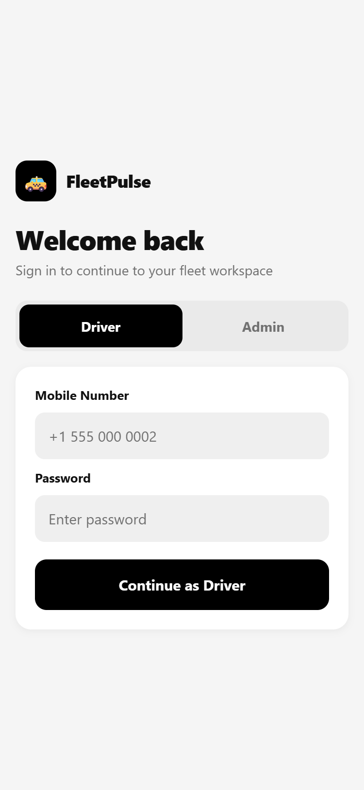
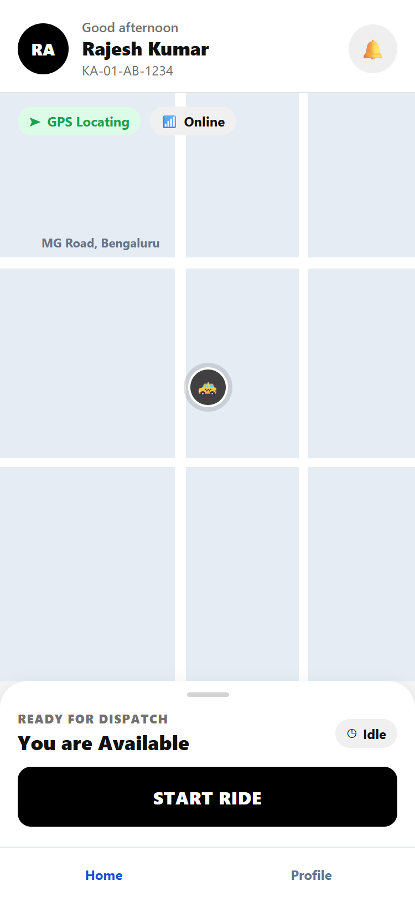
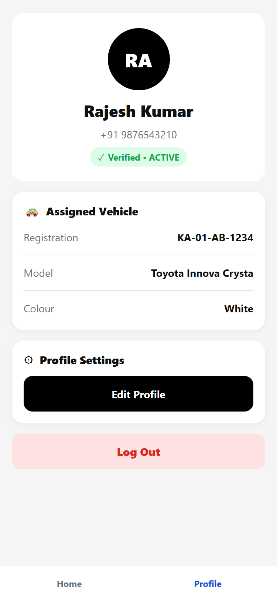
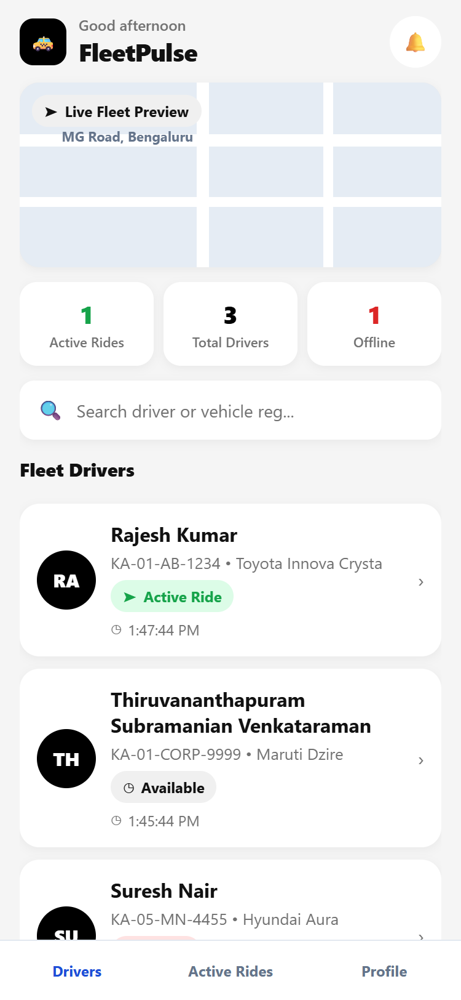
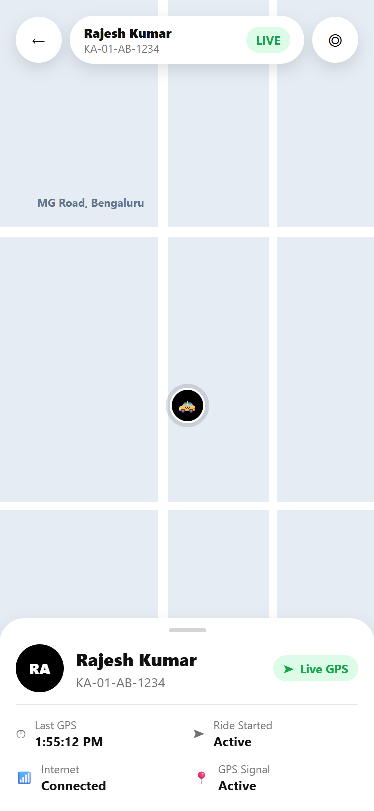
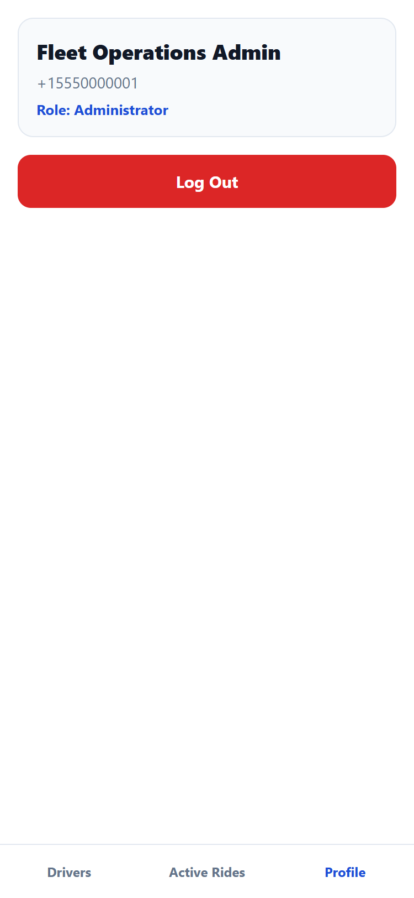
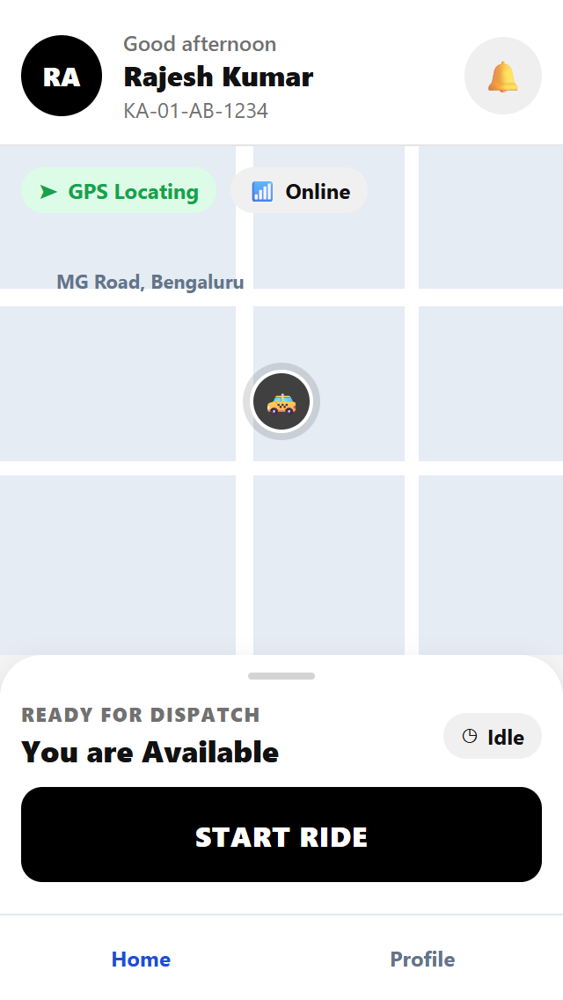
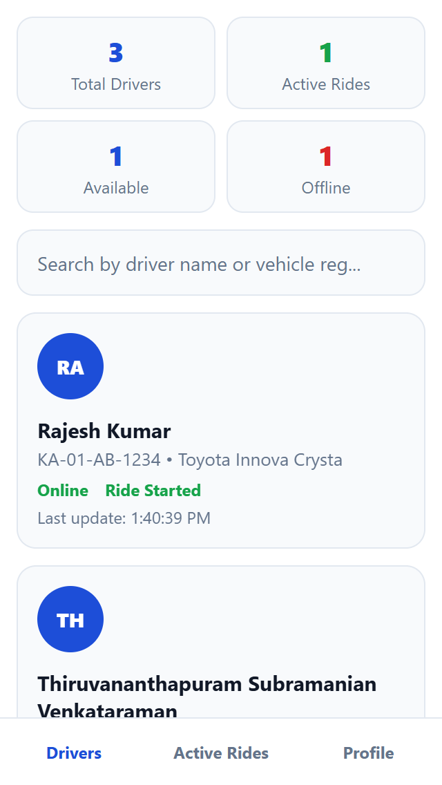
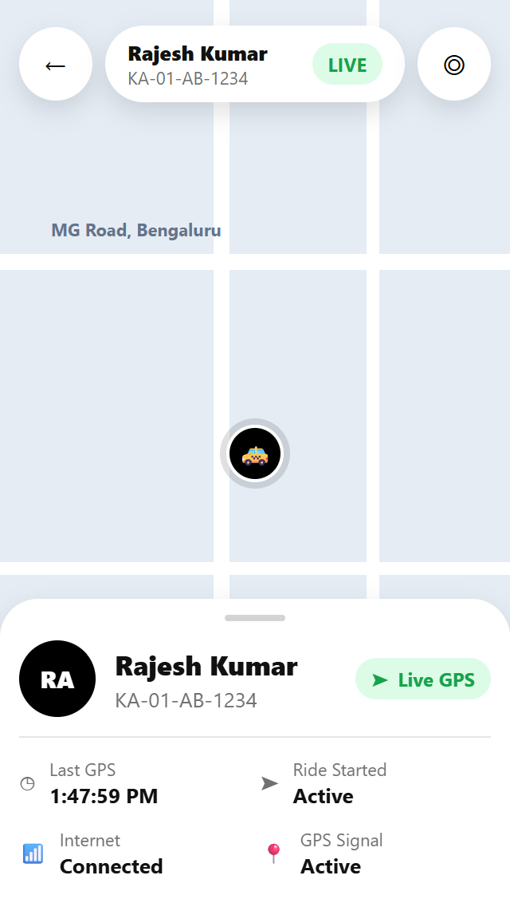

# FleetPulse — Cab Live Tracking Application

Corporate cab live GPS tracking application built with **React Native + TypeScript** (shared Driver & Admin mobile app), **Node.js + Express + Socket.IO**, **PostgreSQL** (with embedded `@electric-sql/pglite` support for zero-install local runs), and **Firebase Cloud Messaging**.

## Monorepo Structure

- `mobile/` — Shared React Native + TypeScript app (Driver & Admin roles, background GPS tracking, offline queue, Keychain/Keystore token storage, Google Maps, runtime Server URL config)
- `backend/` — Node.js + Express + TypeScript REST API, Socket.IO real-time tracking gateway, PostgreSQL schema & migrations, FCM push alerts, plus `/driver` and `/monitor` web views for instant field testing
- `scripts/` — `start-field-test.ps1` launcher for backend + Cloudflare/ngrok HTTPS tunnel
- `screenshots/` — Mobile UI (`375×812`, `320×568`) and live field-test screenshots
- `documentation/` — Setup, database, GPS tracking, security, and testing documentation

## Quick Start (Live Field Test: Laptop + Phone)

1. **Configure & Migrate Database**:
   ```powershell
   cd backend
   cp .env.example .env
   # Use DATABASE_URL=pglite://./data/pgdata for zero-install local PostgreSQL, or your PostgreSQL URI
   npm install
   npm run migrate
   npx tsx src/database/seed.ts
   ```
   Seeded test accounts:
   - **Admin:** `+15550000001` / `Admin@1234`
   - **Driver:** `+15550000002` / `Driver@1234` (`KA-01-AB-1234`)

2. **Start Backend & Public HTTPS Tunnel**:
   ```powershell
   .\scripts\start-field-test.ps1
   ```
   - **Laptop (Admin Live Map):** Open `http://localhost:4000/monitor`
   - **Phone (Driver GPS Tracker):** Open the `https://....trycloudflare.com` URL in your mobile browser (or paste it into **Configure Server URL** in the React Native app) and tap **START RIDE**.

## Live Field-Test Screenshot

| Laptop Admin Monitor (`http://localhost:4000/monitor` receiving live 4G GPS from phone) |
| :---: |
|  |

## Mobile App Screenshots

### Authentication & Driver App (`375×812`)

| Login | Driver Home & Map | Driver Profile |
| :---: | :---: | :---: |
|  |  |  |

### Admin Fleet & Live Tracking (`375×812`)

| Fleet & Driver List | Active Rides | Driver Details |
| :---: | :---: | :---: |
|  |  |  |

| Live Tracking Map | Admin Profile |
| :---: | :---: |
|  |  |

### Small-Device Responsive Verification (`320×568`)

| Driver Home (`320×568`) | Fleet List (`320×568`) | Live Map (`320×568`) |
| :---: | :---: | :---: |
|  |  |  |

## Documentation

- [MVP Setup & Testing Report](documentation/MVP_SETUP_AND_TESTING_REPORT.md)
- [API Documentation](documentation/API_DOCUMENTATION.md)
- [Database Schema](documentation/DATABASE_SCHEMA.md)
- [GPS Tracking Architecture](documentation/GPS_TRACKING.md)
- [Security Architecture](documentation/SECURITY.md)
- [Deployment & Release Checklist](documentation/DEPLOYMENT.md)
