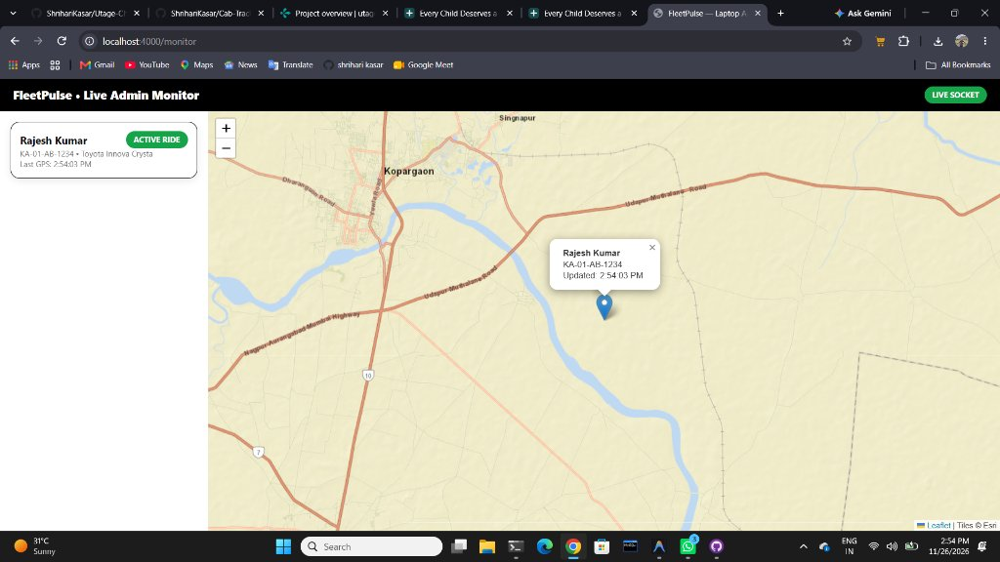
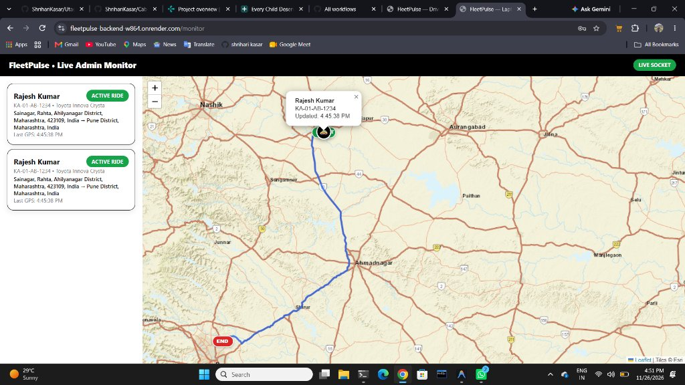
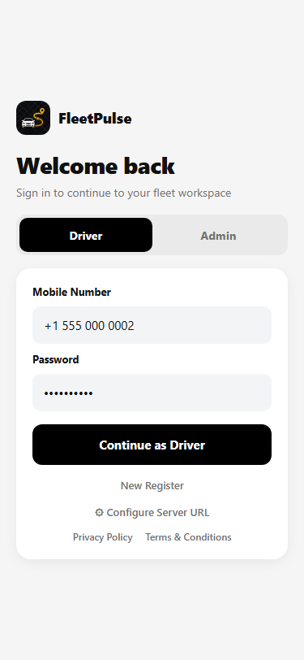
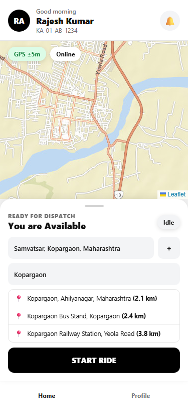
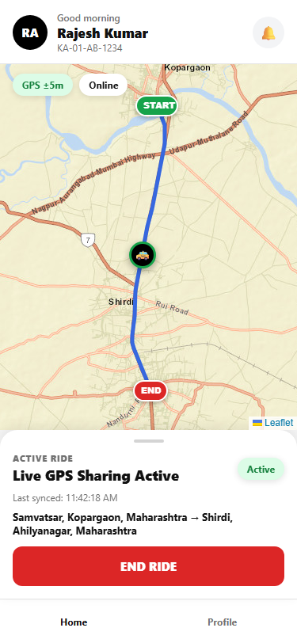
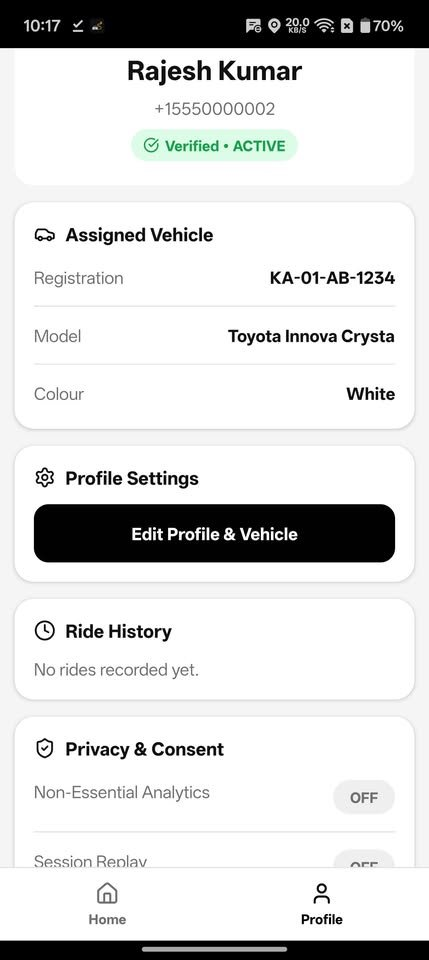
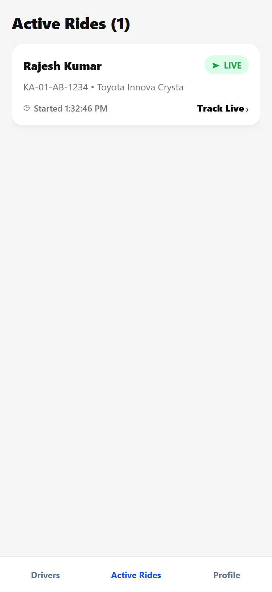
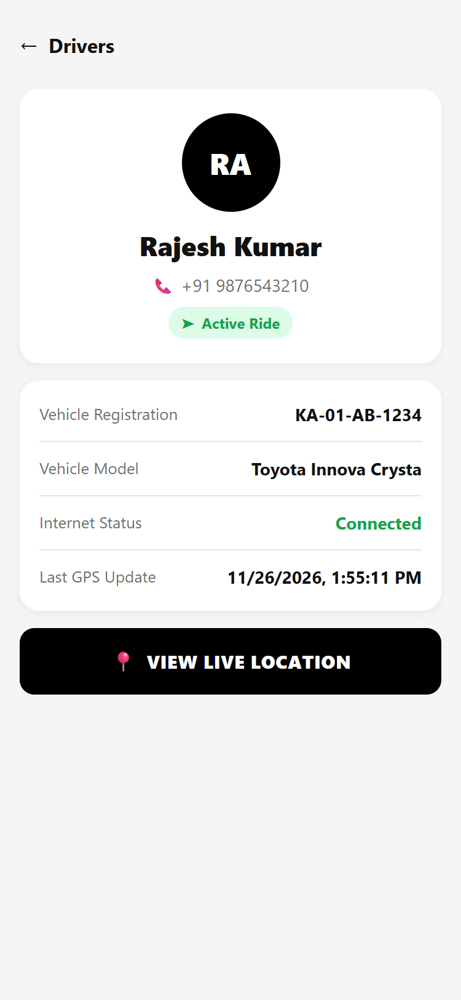
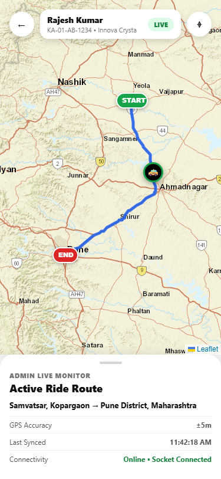

# FleetPulse — Cab Live Tracking Application

Corporate cab live GPS tracking application built with **React Native + TypeScript** (shared Driver & Admin mobile app), **Node.js + Express + Socket.IO**, **PostgreSQL** (with embedded `@electric-sql/pglite` support for zero-install local runs), and **Firebase Cloud Messaging**.

## Live Hosted Links (Production Backend — Render)

- **Driver Web Portal:** https://fleetpulse-backend-w864.onrender.com/driver
- **Admin Live Monitor:** https://fleetpulse-backend-w864.onrender.com/monitor
- **API Base URL:** `https://fleetpulse-backend-w864.onrender.com/api` (default in the mobile app)
- **Health Check:** https://fleetpulse-backend-w864.onrender.com/api/health
- **Privacy Policy:** https://fleetpulse-backend-w864.onrender.com/privacy-policy
- **Terms & Conditions:** https://fleetpulse-backend-w864.onrender.com/terms-and-conditions

## Monorepo Structure

- `mobile/` — Shared React Native + TypeScript app (Driver & Admin roles, background GPS tracking, offline queue, Keychain/Keystore token storage, Google Maps, runtime Server URL config)
- `backend/` — Node.js + Express + TypeScript REST API, Socket.IO real-time tracking gateway, PostgreSQL schema & migrations, FCM push alerts, plus `/driver` and `/monitor` web views for instant field testing
- `scripts/` — `start-field-test.ps1` launcher for backend + Cloudflare/ngrok HTTPS tunnel
- `screenshots/` — Mobile UI (`375×812`, `320×568`) and live field-test screenshots
- `documentation/` — Setup, database, GPS tracking, security, and testing documentation

## Quick Start (Live Field Test: Laptop + Phone)

1. **Configure & Migrate Database**:
   ```powershell
   cd backend
   cp .env.example .env
   # Use DATABASE_URL=pglite://./data/pgdata for zero-install local PostgreSQL, or your PostgreSQL URI
   npm install
   npm run migrate
   npx tsx src/database/seed.ts
   ```
   Seeded test accounts:
   - **Admin:** `+15550000001` / `Admin@1234`
   - **Driver:** `+15550000002` / `Driver@1234` (`KA-01-AB-1234`)

2. **Open Live Portals**:
   - **Laptop (Admin Live Map):** Open https://fleetpulse-backend-w864.onrender.com/monitor
   - **Phone (Driver GPS Tracker):** Open https://fleetpulse-backend-w864.onrender.com/driver (or use the FleetPulse mobile app) and tap **START RIDE**.

## Live Field-Test Screenshots

| Laptop Admin Monitor (receiving live 4G GPS from phone) | Road-Following OSRM Route (`https://fleetpulse-backend-w864.onrender.com/monitor`) |
| :---: | :---: |
|  |  |

## Mobile App Screenshots (`375×812`)

### Authentication & Driver App

| Login & Registration | Distance-Ranked Place Search | Active Ride (Start to End + Live Vehicle) |
| :---: | :---: | :---: |
|  |  |  |

| Driver Profile, Vehicle Edit & Ride History |
| :---: |
|  |

### Admin Fleet & Live Tracking

| Fleet & Driver List | Active Rides | Driver Details |
| :---: | :---: | :---: |
|  |  |  |

| Admin Live Map (Start to End + Moving Cab) | Admin Profile |
| :---: | :---: |
|  |  |

## Documentation

- [MVP Setup & Testing Report](documentation/MVP_SETUP_AND_TESTING_REPORT.md)
- [API Documentation](documentation/API_DOCUMENTATION.md)
- [Database Schema](documentation/DATABASE_SCHEMA.md)
- [GPS Tracking Architecture](documentation/GPS_TRACKING.md)
- [Security Architecture](documentation/SECURITY.md)
- [Deployment & Release Checklist](documentation/DEPLOYMENT.md)
